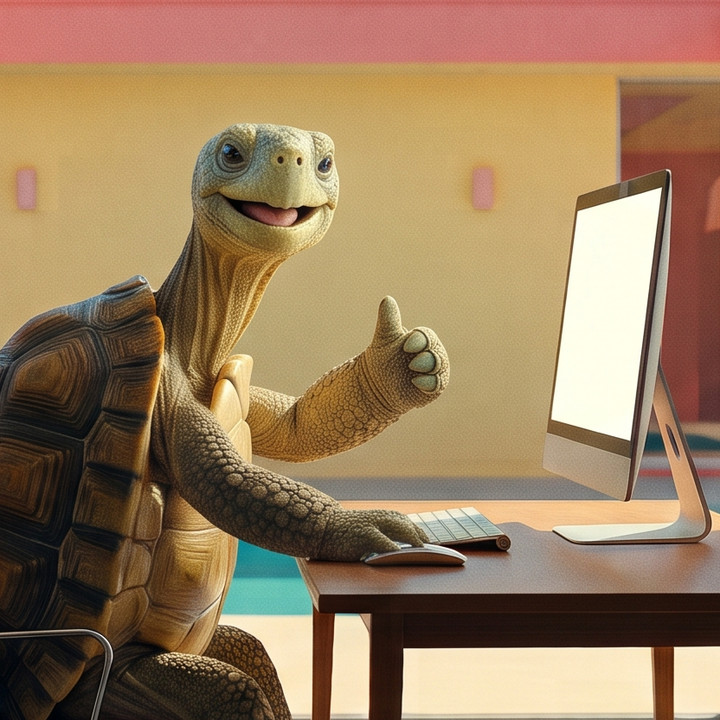
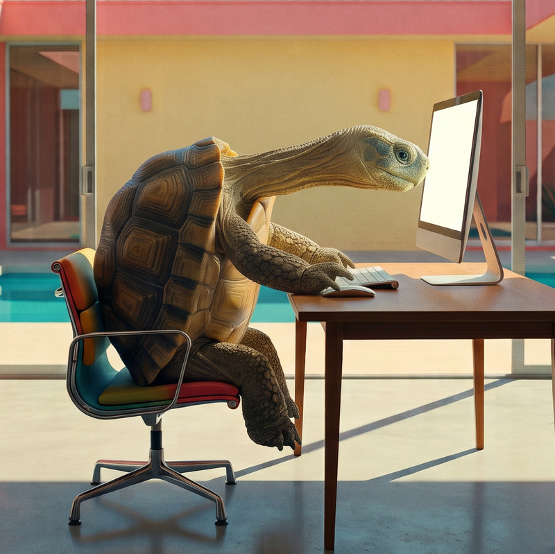
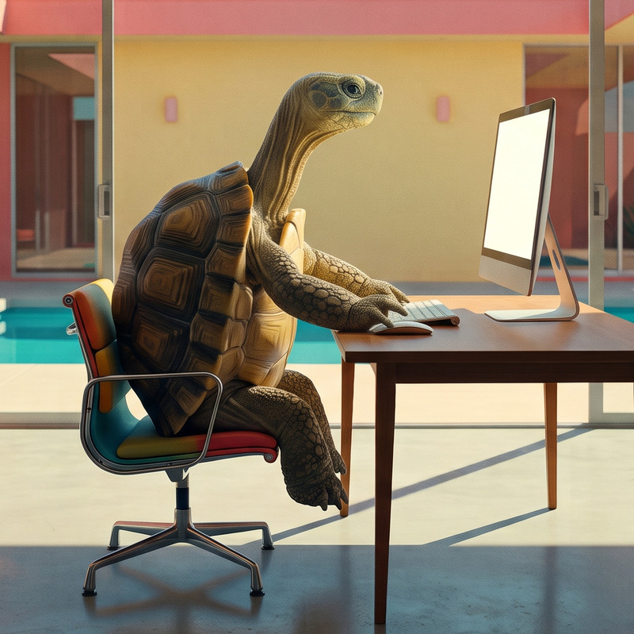
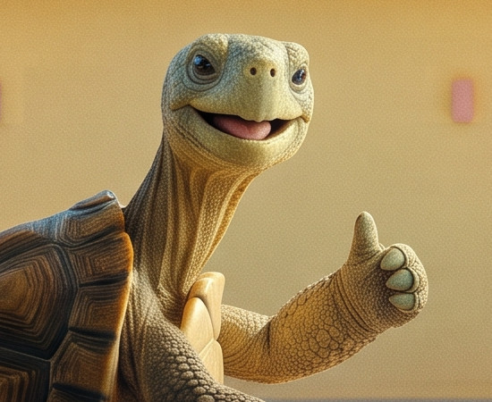

<div align="center">



# Tartaruguinha 🐢

### Sua postura agradece. Seu pescoço também.

**Um coach de postura que mora no seu navegador e avisa, na hora, quando você começa a se curvar.**

</div>

---

## Você só percebe quando já está doendo

Você começa o dia sentado direitinho. Três horas e duas reuniões depois, está dobrado sobre o teclado, com a cabeça projetada para a frente e os ombros caídos. Feito uma tartaruguinha.

Ninguém percebe isso sozinho. Quando o pescoço reclama, o estrago do dia já está feito.

**A Tartaruguinha percebe por você.**

<table>
  <tr>
    <th align="center">😩 Antes</th>
    <th align="center">😎 Depois</th>
  </tr>
  <tr>
    <td></td>
    <td></td>
  </tr>
  <tr>
    <td align="center"><em>14h37. Pescoço a meio caminho do monitor.<br/>Ninguém avisou.</em></td>
    <td align="center"><em>14h38. Um “ding-dong” depois.<br/>Coluna reta, dignidade restaurada.</em></td>
  </tr>
</table>

---

## Como funciona

1. **Ligue a Tartaruguinha.** Com o [Node.js](https://nodejs.org) instalado, entre na pasta do projeto e rode:

   ```bash
   cd Tartaruguinha
   npm run setup   # só na primeira vez
   npm run dev
   ```

   👉 Abra **http://localhost:5173** no Chrome, aceite o aviso de privacidade e clique em **Iniciar**. Não precisa de cadastro.
2. **Trabalhe normalmente.** A webcam observa sua postura em tempo real, em silêncio.
3. **Curvou? Ela avisa.** Um toque suave, um brilho na tela e uma notificação. Endireitou? Ela volta a ficar quietinha.

Ela não fica apitando o tempo todo. Ela só fala quando importa.

---

## Por que você vai gostar

### ⚡ Feedback na hora
Nada de lembrete de hora em hora que não tem nada a ver com a sua postura real. O aviso chega no momento em que você se curva, e o hábito se corrige enquanto ainda é fácil corrigir.

### 🔒 Sua imagem nunca sai do seu computador
Toda a análise acontece no seu próprio aparelho. Nenhuma foto e nenhum vídeo é enviado, gravado ou guardado, nem por nós, nem por ninguém. Só você vê a sua câmera.

### 👀 Você vê o que ela vê
Um esqueleto desenhado sobre a sua imagem mostra exatamente o que está sendo observado, com cores que dizem tudo de relance:

| | |
|---|---|
| 🟢 **Verde** | Postura boa. Continue assim. |
| 🔴 **Vermelho** | Você está curvado. Hora de endireitar. |
| ⚪ **Cinza** | Não estou vendo seu tronco. Ajuste o enquadramento. |
| 🟡 **Amarelo** | Não tenho certeza. Melhore a luz ou a posição. |

### 🤫 Gentil, não chata
Depois de um aviso, ela espera um pouco antes de avisar de novo. Um piscar de olhos ou uma sombra não disparam alarme falso. A ideia é ajudar, não irritar.

### 🎛️ Do seu jeito
Mais rigorosa ou mais tolerante? Som mais alto, mais baixo ou desligado? Avisos mais ou menos frequentes? Tudo se ajusta em segundos no painel de configurações, e ela lembra das suas preferências.

### 🪟 Continua de olho enquanto você trabalha
Pode trocar de aba ou abrir outro programa: ela continua analisando e avisa por som e notificação, e o título da aba vira **"🟢 Tartaruguinha está de olho!"**. Prefere ver a câmera o tempo todo? Escolha a **janela flutuante**, que fica por cima das outras janelas com sua imagem, o tempo de sessão e os alertas. Se quiser, ela também pode pausar sempre que a aba ficar oculta.

### 📱 No computador e no celular
Funciona no navegador do computador e no Android, e pode ser instalada como um app com ícone na tela inicial.

### ⏱️ Acompanhe sua sessão
Um cronômetro mostra há quanto tempo você está trabalhando e um contador mostra quantas vezes ela precisou te chamar. Precisa de uma pausa? **Pausar** e depois **Retomar** continua a mesma sessão. O botão de reiniciar começa uma nova.

### 📈 Veja sua evolução
O histórico guarda cada sessão com data, hora, alertas e quanto tempo você passou com boa postura e curvado. Cada sessão mostra quanto você melhorou (em verde) ou piorou (em vermelho) em relação à anterior. Ver esse número cair dia após dia é muito satisfatório. Dá para apagar uma sessão ou limpar tudo quando quiser.

---

## Feita com respeito à sua privacidade

- ✅ A câmera só liga quando você clica em **Iniciar**.
- ✅ Um indicador sempre mostra se o monitoramento está ligado.
- ✅ O botão **Pausar** desliga a câmera na hora.
- ✅ Trocou de aba? O título da aba avisa que ela continua de olho. Se preferir, ela pausa sozinha.
- ✅ O histórico fica só no seu navegador. Nada de reconhecimento facial, contas ou dados na nuvem.

---

## Pra quem é

- 💻 **Quem trabalha de casa** e passa o dia em chamadas de vídeo.
- 📚 **Estudantes** em longas maratonas de estudo.
- 🎮 **Qualquer pessoa** que senta muitas horas em frente a uma tela e quer cuidar de si sem esforço.

> A Tartaruguinha é uma ajuda para criar um hábito melhor, não um aconselhamento médico. Se você sente dores frequentes, procure um profissional de saúde.

---

<div align="center">



**Endireita essa coluna. A Tartaruguinha está de olho. 🐢**

</div>
